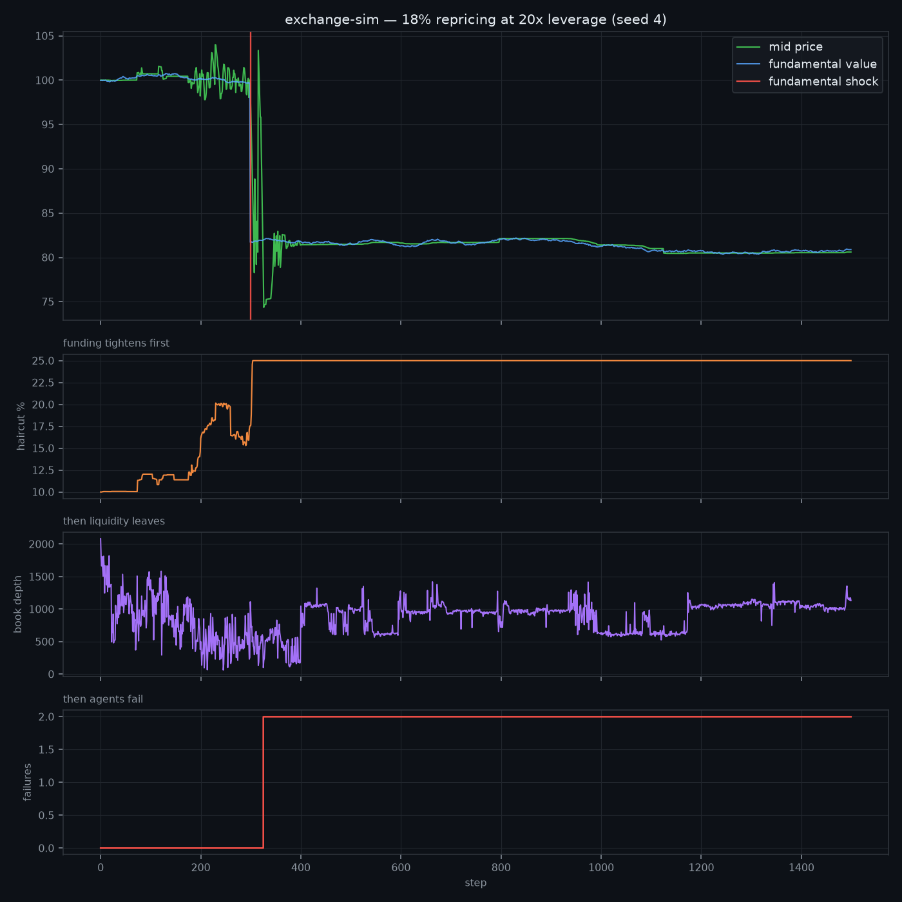
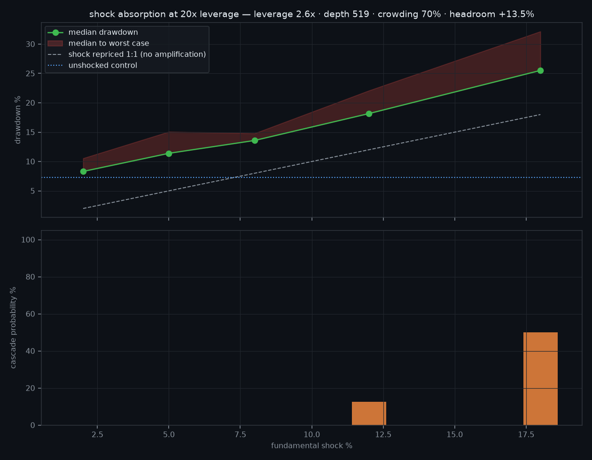
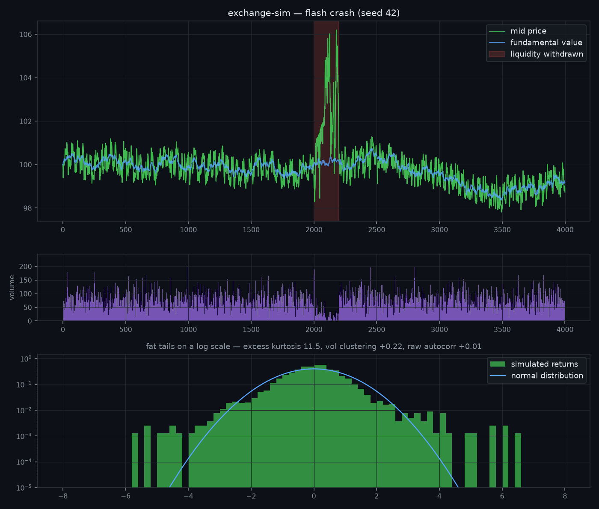

# 🏛️ exchange-simulator

**An agent-based market where realistic behaviour — and realistic failure — *emerges*.** Dealer banks, levered hedge funds, HFT market makers, pension funds and retail traders trade against each other on a real price-time priority matching engine (from [quantsim](https://github.com/hilothefunnydog123-coder/quantsim)), financed by a real funding network. Nobody programs the market to have fat tails, volatility clustering, flash crashes or deleveraging spirals — those emerge from the interaction, and the test suite verifies them statistically.



*An 18% fundamental repricing hits a market financed at 20x. Nothing after the red line is scripted. Haircuts widen from 12% to 25%, book depth collapses from ~836 resting shares to 99, price overshoots to −28.5%, and 26 steps later two momentum funds run out of equity and fail — writing 9,559 off against both dealers, split pro-rata. Run the same shock at 3x and none of it happens.*

---

## ⚠️ Read this before anything else

This simulator **cannot predict crashes, and does not try to.** If you came here hoping for something that tells you when SPY will fall, this is not it, and you should be sceptical of anything that claims to be — a model that reliably called crashes would stop working the moment anyone traded on it.

Three specific reasons it can't:

1. **The information isn't in the input.** The 2007 trigger was subprime loan performance, ratings-model error and off-balance-sheet exposure nobody could see. A model fed price data contains none of that.
2. **Reliable crash-timing is self-destroying.** Anything that worked would be arbitraged away as soon as it was used.
3. **The best-funded attempts don't do it either.** The Fed, Bank of England and ECB all run agent-based systemic-risk models, with regulatory data you and I can't get. **None of them forecast crisis timing.** They do scenario analysis and fragility measurement, because that's what this class of model can honestly deliver.

**What it does instead** is answer the question those institutions actually ask, and the one an agent-based model can answer honestly:

> Given the state this market is in right now — this much leverage, this much resting depth, positions this crowded — how large a shock does it take before losses stop being absorbed and start cascading?

That is a statement about **fragility**, which is measurable. It is not a statement about what will happen, which isn't. See [`fragility.py`](exchange_sim/fragility.py).

---

## 🚀 Quickstart

```bash
pip install "exchange-simulator[plot] @ git+https://github.com/hilothefunnydog123-coder/exchange-simulator.git"

exchange-sim run --steps 4000 --seed 42 --plot market.png
exchange-sim run --scenario credit-crisis --leverage 20 --plot crisis.png
exchange-sim fragility --leverage 20 --plot fragility.png
exchange-sim replay --synthetic gfc --plot replay.png
```

**No terminal?** Open [colab.research.google.com](https://colab.research.google.com), make a new notebook, and run one cell:

```python
!pip install -q "exchange-simulator[plot] @ git+https://github.com/hilothefunnydog123-coder/exchange-simulator.git"

from exchange_sim import systemic_market, shock_response
ex = systemic_market(seed=42, fund_leverage=20, base_haircut=0.10)
ex.run(300)
print(shock_response(ex, runs=8).summary())
```

---

## 🧱 The four layers

### 1. Balance sheets, leverage and default — [`balance.py`](exchange_sim/balance.py)

Every agent has cash, inventory, **debt** and **receivables**. Equity is what's left marked to market. An agent financed too thin gets a margin call and must sell; an agent whose equity goes negative **fails**, its book is liquidated into the order book at whatever price it will bear, and whatever it can't repay is **written off against its creditors** — who may then fail themselves. The cascade loop runs to a fixed point, so one failure can take down a chain.

Conservation still holds through all of it. Lending moves cash without creating it; a write-off destroys a *claim* (debt on one side, receivable on the other) and touches no cash. So across all agents:

```
total cash    invariant
total shares  invariant
total equity  == total cash + total shares × mid      (claims cancel pairwise)
```

### 2. The institutional zoo — [`institutions.py`](exchange_sim/institutions.py)

What separates these agents is not their signal — several trade on much the same view — but their **balance sheet** and their **funding**.

| Agent | Role | What it contributes |
|---|---|---|
| **DealerBank** | quotes markets *and* finances everyone else | the spread — and the haircut. When scared it does both at once: quotes wider **and** lends less |
| **LeveredHedgeFund** | momentum or value, run at 3–6x | forced selling. Sized to leverage, so a move against it forces sales regardless of what it believes |
| **HFTMarketMaker** | tightest quote, smallest size, runs flat | most of the visible depth in calm markets, none of it in a crash |
| **PensionFund** | enormous, unlevered, slow | the only reliable buyer in a crash — arriving long after the crash |
| **RetailTrader** | small, herds on returns, capitulates | panic supply at the bottom |
| **MarketMaker / NoiseTrader / MomentumTrader / FundamentalTrader** | the original four | microstructure: spread, background flow, amplification, anchoring |

The **funding channel** matters more than any single agent. `FundingDesk` translates dealer risk appetite into every borrower's maintenance margin — so a haircut moving from 20% to 34% mechanically margin-calls every fund financed at 4x, **simultaneously**. No agent decides to start a spiral.

### 3. The fragility gauge — [`fragility.py`](exchange_sim/fragility.py)

Freeze the market's current state, deep-copy it, hit the copy with a shock of size *s*, run it forward. Many times per shock size, across a ladder of sizes — plus an **unshocked control**, so the market's own wander isn't counted as damage the shock caused.



```
state: leverage 2.6x · depth 519 · crowding 70% · headroom +13.5%
control (no shock): median drawdown -7.3% over 400 steps

  shock  median dd  worst dd   excess  amplif  cascade
  2.0%      -8.3%    -10.5%     1.0%    0.51x       0%
  5.0%     -11.4%    -15.1%     4.1%    0.82x       0%
  8.0%     -13.6%    -14.8%     6.3%    0.79x       0%
 12.0%     -18.2%    -22.1%    10.9%    0.91x      12%
 18.0%     -25.5%    -32.2%    18.2%    1.01x      50%

absorbed cleanly up to : 8.0%
cascades from          : 18.0%
first to fail          : momofund2 (2), momofund1 (2), momofund0 (1)
```

Read the **bend**, not the level. Below 8% a shock is just a repricing. By 18% it takes out funds half the time. The gauge also names the weak link — which agent fails *first*, most often.

### 4. Historical replay — [`history.py`](exchange_sim/history.py)

Drive the fundamental from a **real price series** instead of a random walk, and watch the ecology trade through it:

```bash
exchange-sim replay --symbol spy.us --start 2007-01-01 --end 2009-06-30 --plot gfc.png
```

**Be clear about what this proves.** It's a test of the *mechanism* — does an ecology with this much leverage reproduce the drawdown and funding stress that actually showed up? It is **not** a forecast and not a strategy backtest. The model is being *handed* 2008 and asked what a levered market does with it. It is not discovering that 2008 was coming.

Replaying the real 2006–2009 S&P 500 (a −50.8% drawdown) through ecologies at different leverage:

| fund leverage | emergent drawdown | overshoot vs fundamental | failures |
|---|---|---|---|
| 1.5x | −52.3% | −1.5% | 1 |
| 3x | −49.9% | +0.9% | 3 |
| 6x | −100.0% | −49.2% | 10 |
| 20x | −100.0% | −49.2% | 12 |

The bottom two rows are **the model breaking, not a finding**. At 6x and above, a 50% fundamental decline leaves no equilibrium: forced selling clears the book and price pins to the tick floor, so −100.0% is a floor artefact rather than a market outcome. Trust the 1.5–3x rows; treat anything that hits exactly −100% as out of range. Reporting the failure mode rather than quietly showing you the 3x row is the point.

---

## 🔬 What the tests actually verify

**45 tests.** Two kinds, deliberately.

**Mechanism tests** build a tiny hand-made market and assert exactly what must happen — deterministic, and the ones that would catch a real accounting bug:

1. Lending moves cash without creating it; a lender can't lend what it doesn't have
2. A write-off destroys a claim and touches **no cash**
3. `total equity == total cash + total shares × mid`, before and after write-offs
4. An insolvent agent fails, is liquidated, and **its creditor absorbs the shortfall**
5. A thin-but-solvent borrower is margin-called and forced to sell — without defaulting
6. Cash and shares survive a full credit crisis: margin spirals, fire sales, write-offs
7. A failed agent's estate keeps hitting the book for steps afterwards, not all at once
8. The exchange clamps orders agents should never have sent (zero/negative/NaN prices and sizes) instead of crashing

**Emergent tests** run the full ecology and assert statistical properties across seeds — written loosely on purpose, checking the *direction* of an effect rather than pinning numbers that would make the suite fragile without making the model correct:

9. **Fat tails** — excess kurtosis of returns > 0
10. **Volatility clustering** — |returns| autocorrelated
11. **No free momentum** — raw return autocorrelation ≈ 0
12. **Anchoring** — median gap between price and fundamental stays bounded
13. **The flash-crash double experiment** — the same sell program with liquidity present (mild dip) and withdrawn (crash > 2%, V-recovery). The crash needs **both** ingredients — exactly the finding of the SEC/CFTC report on May 6, 2010
14. **Funding tightens as the market falls**, and dealers quote smaller when stressed
15. **Damage is monotone in shock size**, measured against an unshocked control
16. **A heavily levered, loosely financed system is at least as fragile** as a conservative one, under an identical shock

Stylized facts 9–11 mirror the classic properties of asset returns (Cont, 2001).

---

## 🧪 Run your own experiments

The cleanest experiment in the repo: **same shock, same everything, vary only leverage.**

```python
from exchange_sim import systemic_market, leverage_sweep

results = leverage_sweep(
    lambda lev, seed: systemic_market(seed=seed, fund_leverage=lev, base_haircut=0.10),
    leverages=(3, 6, 12, 20), shock=0.18,
)
for lev, out in results.items():
    print(f"{lev:>2}x  cascade probability {out.cascade_probability:.0%}  "
          f"failures {out.failures}")
```

Or write a new agent — one `act()` method, drop it in, measure how it changes the market:

```python
from exchange_sim import Agent, OrderIntent

class PanicSeller(Agent):
    def act(self, view, rng):
        if view.drawdown < -0.05 and self.inventory > 0:
            return [OrderIntent("market", "sell", self.inventory)]
        return []
```

### Running against real data

`exchange-sim replay` fetches from [stooq](https://stooq.com) by default, which needs outbound network access. **Many sandboxes block this** — including Claude Code's default network policy. When that happens you get an error naming the host, *never* a silent fallback to synthetic data:

```
could not load data: could not reach stooq.com for 'spy.us': Tunnel connection failed: 403 Forbidden
```

Three ways round it:

```bash
exchange-sim replay --sp500 --start 2006-01-01 --end 2009-12-31   # real, via GitHub
exchange-sim replay --csv ./spy.csv                # any CSV with Date,Close columns
exchange-sim replay --synthetic gfc                # SYNTHETIC, and labelled as such
```

`--sp500` pulls **real** S&P 500 closes from a [public dataset repo](https://github.com/datasets/s-and-p-500), which usually works even in sandboxes that block market-data hosts — they still need GitHub to fetch code. Two caveats: the series is **monthly** (four years ≈ 48 points, so intra-month structure in the replay is interpolation artefact, not data), and it is consumed as a *fundamental*, not as a tape.

Synthetic episodes (`calm`, `bull`, `gfc`, `covid`, `bear2022`) are regime-*shaped* series for offline work. They are always marked `is_real=False` and print as `SYNTHETIC`. Calling one `"gfc"` describes its shape, not its provenance — a synthetic series quietly standing in for a real one is exactly how a model ends up "validated" against nothing.

---

## 📊 The other scenarios

```bash
exchange-sim run --scenario default        # the original four-archetype market
exchange-sim run --scenario systemic       # full institutional stack, credit live
exchange-sim run --scenario flash-crash    # 2010: liquidity withdrawal
exchange-sim run --scenario credit-crisis  # 2008: repricing into leverage
```

`flash-crash` and `credit-crisis` are the two different ways a market breaks. The first is a *liquidity* crisis — nobody borrows, nobody fails, the book just empties. The second is a *credit* crisis — the loss is somebody else's asset.



---

## ✅ Tests

```bash
pip install -e ".[dev]" && pytest
```

## 📄 License

MIT. Simulated money only — though the lessons about leverage are uncomfortably real.
